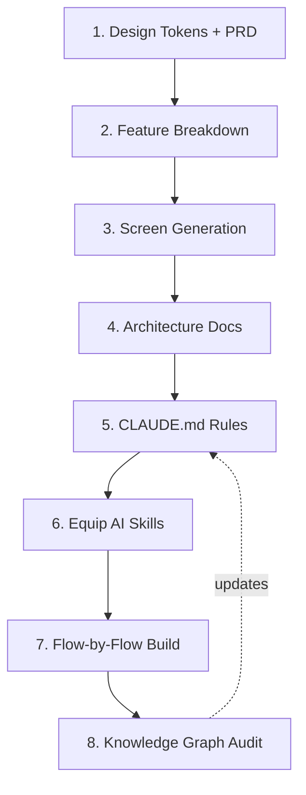

# AI-Assisted Flutter Development Workflow

This document describes the 8-step playbook for building production-grade Flutter apps with an AI coding agent, leveraging design systems, clean architecture, and project-specific skills. Each step includes an **Improvement** note — a lesson worth applying from the start rather than retrofitting later.

---

## The 8-Step Developer Loop



The loop back into step 5 matters: `CLAUDE.md` is never "done" after step 5 — every skill you add in
step 6, and every drift step 8 surfaces, should be written back into it. Treat it as the one file
every future session (yours or a teammate's) reads first.

### Step 1: Design Tokens + PRD
Paste your product requirements document (PRD) into the AI design tool. Generate design tokens (colors, typography, spacing, border radii) as CSS variables or JSON before creating any screens. Save these under `docs/design_systems/tokens/`.

**Design Token Sources** — pick whichever fits your project, they all converge on the same output:
- **Prompt-generated**: paste the PRD (Prompt 1 below) and have the AI derive a palette/scale from scratch. No external tooling required.
- **Design-tool MCP** (e.g. a Figma MCP server): if one is connected, pull the token values directly from an existing design file instead of describing them in prose. Only use this path if the MCP is already configured — don't add it as a hard dependency for consumers of this template who don't have it.
- **Hand-authored**: write the CSS files directly under `docs/design_systems/tokens/` if the design system already exists elsewhere (a brand guide, an existing app) and just needs transcribing.

Whichever source you use, the deliverable is the same: `colors.css`, `spacing.css`, and `typography.css` (or equivalent) under `docs/design_systems/tokens/`, mirrored into Flutter's `ThemeExtension`/`ThemeData` in `lib/core/theme` — never hardcode a color/spacing/type value in feature code.

> **Improvement**: also ask for the *rules of usage* alongside the tokens (when to use a semantic color vs. a brand color, contrast minimums, spacing increments) in the same pass — backfilling a usage-guidelines doc after the fact costs more than asking for it up front.

### Step 2: Break the PRD into Features
Ask the AI to parse the PRD and map it into a numbered list of independent feature areas. Create one spec file per feature under `docs/features/` along with an `index.md`. Each file should specify user stories, data models, and feature dependencies.

> **Improvement**: do this *before* any screen mockups, not interleaved with them. Doing it first gives the design tool a stable feature vocabulary to tag every subsequent screen with, which pays off directly in Step 7 when you ask for "the X flow."

### Step 3: Screen Specifications feature-by-feature
Develop detailed screen outlines. Identify empty states, loading indicators, offline layouts, and validation error designs. Keep a running screen index under `docs/screen_flow.md`.

> **Improvement**: from day one, also produce a single master screen index (screen ID → composing widgets → which feature/flow it belongs to) as its own artifact, plus a dedicated *cross-cutting states* file (offline banner, skeleton loaders, empty states, generic error) shared across all screens. Building these in Step 3 instead of retrofitting them once you notice empty/loading states being reinvented per-screen saves a rework pass.

### Step 4: Technical Architecture Docs
Detail the database schemas, network paths, and local caching decisions. Document which system acts as the source of truth for each computed value.

> **Improvement**: write down known conflicts between the design mockups and the PRD as you find them, in a living doc, rather than resolving them silently in code — future sessions (yours or a teammate's) need to know a decision was made and why, not just see the resulting code.

### Step 5: CLAUDE.md Configuration
Update `CLAUDE.md` with strict boundaries: features isolation, chosen state management rules, local-first cache expectations, and test coverage targets.

> **Improvement**: link out to the docs from Step 4 rather than duplicating them — `CLAUDE.md` should be the *index of rules*, not a copy of the architecture doc. Treat it as living: every time Step 6 adds a skill, or Step 8 surfaces a violation of a rule that wasn't written down, add a line here.

### Step 6: Equip AI Skills
Equip the AI coding assistant with durable skills at `.claude/skills/` (e.g. Clean Architecture scaffolding checklists, design-token check validations, widget overflow tests).

> **Improvement**: add feature-scaffolding, data-sync, and state-management skills at the same time as your first audit/testing skills, rather than one at a time once you notice you're re-explaining the same constraints every session. If your product has a domain-specific compliance requirement, bake it into a skill rather than relying on remembering to ask for it every time.

### Step 7: Flow-by-Flow Build
Build one logical flow at a time (e.g., onboarding, user settings) rather than screen-by-screen. Ask the AI to build in order: Domain Entity → Repository Interface → Use Cases → Riverpod Controller → Presentation UI.

> **Improvement**: run the responsiveness and audit skills from Step 6 *at the end of each flow*, not in a separate later pass. Catching a layer-boundary violation or a keyboard-overflow bug immediately after generating a flow is far cheaper than finding it three features later.

### Step 8: Knowledge Graph Audit
Run context auditing tools (like `graphify`) to detect circular imports, feature-boundary violations, or missing abstractions, and feed corrections back into `CLAUDE.md`.

> **Improvement**: don't run this once at the end — re-run it after every few flows in Step 7 and feed drift back into Step 5, so the graph stays a live health check rather than a one-time audit. Pair it with a lightweight, file-based memory practice: the graph answers "how is the code connected"; memory answers "what did we decide and why, across sessions" (design-vs-PRD conflicts, feedback on approach, in-flight project state). The two are complementary, and a multi-month project needs both.

---

## Reusable AI Prompts

### Prompt 1 — Design Tokens + PRD
```markdown
We are building a production-grade Flutter application. Here is our PRD:
[Paste PRD here]

Based on this PRD, create a tokenized design system. Include:
1. Color palette (primary, secondary, semantic accents, neutrals, surfaces).
2. Typographic scale (sizes, line heights, weights).
3. Spacing grid, radius scale, shadow scale, and motion/easing tokens.
4. A short usage-rules note per category (when to use semantic vs. brand color, contrast minimums, spacing increments).
Output as CSS custom properties (or a token JSON) plus a one-page rationale. Do not write Dart code yet.
```

### Prompt 2 — Feature Spec Breakdown
```markdown
Here is our PRD: [reference or paste it].

Break it into a numbered list of feature areas. For each feature, produce a spec file containing:
1. User stories / jobs-to-be-done.
2. Data entities and screens touched.
3. Dependencies on other features (call out anything that would create a cross-feature import).
4. Safety, security, or regulatory constraints specific to this feature.
Also produce an index.md listing every feature file.
```

### Prompt 3 — Feature-by-Feature Screens
```markdown
Using our design tokens and the feature spec for [Feature Name], generate the screen layout guidelines. Include:
1. Every state per screen: loaded, loading/skeleton, empty, error, offline.
2. A screen ID for each screen (e.g., ONB-01, SET-02).
Add each new screen ID to docs/screen_flow.md. Do not write Flutter widgets yet.
```

### Prompt 4 — Technical Architecture
```markdown
Based on the PRD and the feature specs, write the technical architecture docs for this Flutter app:
1. architecture.md — tech stack, folder structure (Clean Architecture per feature), state management, local database schema, networking strategy, error handling, testing strategy, Definition of Done.
2. A data-flow doc — local schema, remote schema, sync direction, and source of truth rules.
3. Explicitly note anywhere this doc supersedes or conflicts with the PRD, and why.
```

### Prompt 5 — Rules Index (CLAUDE.md)
```markdown
Based on architecture.md and the data-flow doc, generate CLAUDE.md for this repository:
1. Feature-boundary rules (what a feature may and may not import).
2. State management constraints (Riverpod code-gen rules, no inline widget logic).
3. Data caching rules (Drift SQLite configurations, local-first vs remote-first).
4. Theme rules (no hardcoded color/spacing/typography).
5. Lint/test gates.
Link out to the docs rather than duplicating their content.
```

### Prompt 6 — Equip Skills
```markdown
Create a Claude Code skill at .claude/skills/[skill-name]/SKILL.md for:
[Choose: clean architecture auditing | design-token compliance | responsive layout audits | test generation | feature scaffolding | data-sync wiring | state-management scaffolding | domain-specific compliance checks].
The skill should act as a checklist of rules for the AI coding assistant to verify before finishing feature work, referencing the specific rules in CLAUDE.md and architecture.md, with concrete trigger phrases for when it should auto-fire.
Then add one line to CLAUDE.md's skills section pointing to it.
```

### Prompt 7 — Flow-by-Flow Implementation
```markdown
We are ready to implement the [Feature Name] flow (screens: [screen IDs], flow doc: docs/screen_flow.md).
Generate the code in this exact order:
1. Domain entity + Repository interface contract.
2. Domain use case (encodes business rules).
3. Riverpod controller/notifier.
4. Presentation widgets using ThemeExtension design tokens.
When finished, run the responsiveness and boundary audit skills against this flow before moving to the next one.
```

### Prompt 8 — Knowledge Graph Audit
```markdown
/graphify
Build/refresh the knowledge graph for this workspace. Then report:
1. Any import that crosses a feature boundary CLAUDE.md prohibits.
2. Circular dependencies or orphaned modules.
3. Community hubs that have grown large enough to suggest a missing abstraction.
Feed anything found back as a fix task, and flag any rule it exposes that CLAUDE.md doesn't document yet.
```

---

## Skills & Superpowers to Equip

### Bundled with this template
| Skill | Purpose |
|---|---|
| `flutter-feature-scaffold` | Generates the Clean Architecture boilerplate (entity, repo interface, use case, controller, DTO, datasource, repo impl) for a new feature. |
| `api-data-sync` | Wires Firestore remote datasources, Drift local DAOs, and the offline sync queue consistently. |
| `riverpod-state-management` | Providers/controllers/notifiers, async loading/error state, test overrides. |
| `flutter-ui-design-system` | Keeps widgets on design tokens; catches hardcoded color/spacing/type. |
| `flutter-overflow-audit` | Keyboard-open / RenderFlex overflow checks for forms, sheets, modals. |
| `flutter-testing` | Unit/repository/widget/golden tests matched to the layer being tested. |

| Command | Purpose |
|---|---|
| `/new-feature <name>` | Scaffolds folders and `.gitkeep` files for a new Clean Architecture feature. |
| `/create-screen <name>` | Generates a screen page using theme tokens. |
| `/create-provider <name>` | Scaffolds a Riverpod controller/notifier. |
| `/create-model <name>` | Scaffolds an immutable data model. |
| `/connect-api <name>` | Wires a feature's remote datasource to REST (Dio) or Firestore. |
| `/generate-tests <target>` | Generates tests for a given class/file, matching its architectural layer. |
| `/refactor-widget <target>` | Extracts or promotes a widget, applying the shared-vs-feature-local boundary rule. |
| `/review-code` | Reviews a diff/file against this project's architecture rules. |
| `/dod-check` | Performs a Definition of Done audit. |
| `/audit-architecture` | Runs a repo-wide architecture/compliance audit. |

### General-purpose, worth adding to any AI-assisted Flutter project
| Skill | Why it earns a slot |
|---|---|
| `security-review` | Pre-merge pass for injection/secrets/OWASP-class issues — cheap insurance on any app handling user data. |
| `code-review` / `simplify` | Independent second pass for correctness and over-engineering before merging a flow. |
| `dataviz` | If the product has any charts/progress graphs, gives consistent, accessible chart styling instead of ad hoc plotting choices. |
| `a11y-compliance` *(build this one)* | Screen-reader labels, contrast, touch-target size — not covered by the overflow-audit skill above, which is layout-only. |
| `performance-audit` *(build this one)* | const-constructor discipline, rebuild-tree checks, memory leaks — worth adding once the app has enough screens that jank becomes possible. |
| `l10n` *(build this one, if multi-language is planned)* | Standardizes ARB-based localization instead of ad hoc string tables. |
| `fewer-permission-prompts` | Run once the workflow stabilizes — scans your own transcript history and pre-allowlists the read-only commands you approve every time anyway. |
| `loop` | Useful for making Step 8's graphify re-check (see the Step 8 Improvement note above) actually recurring instead of manual. |
| A domain-specific compliance skill *(build this one if applicable)* | If your product has a regulated or safety-critical domain, bake its rules (thresholds, consent, required disclosures) into a skill rather than relying on remembering to ask for them every time. |

Update `CLAUDE.md`'s skills section every time a skill is added, so the rule and the automation that enforces it stay next to each other.

---

## Challenges Faced Building an AI-Assisted Flutter Project

A few things tend to trip people up when using AI tools for design, coding, and a local-first
backend together. None of these mean the 8-step loop is wrong — they're just worth knowing about
ahead of time:

- **The PRD and the design mockups can disagree.** They're often created separately, so they don't always match on the same numbers or screens. Don't just trust one over the other — when they disagree, check both and write down which one you went with and why.
- **One small database change can touch many files.** In Drift, adding a single column means updating the table definition, the repository, and the datasource's save/update code too. It's easy to forget one spot — a checklist helps more than trying to remember it every time.
- **Generated code files add noise to your diffs.** Riverpod regenerates `.g.dart` files any time you touch a provider, even for an unrelated change. Review those generated-file diffs before you commit instead of staging everything blindly.
- **Testing on a real device has its own quirks.** Tools like `adb` behave a little differently than you'd expect — file paths can get mangled, screenshots may come back at a different resolution than the device actually has, and a key press meant to close the keyboard can end up closing an entire popup instead. Write these down the first time you hit one.
- **Long projects need decisions written down, not just remembered.** A choice made in one session (why you picked one option over another) can get lost if it only lives in someone's memory. Keep a simple decision log alongside your code so a later session — yours or a teammate's — knows what was already decided and why.
- **CLAUDE.md and skills only help if you keep them updated.** They're useful in proportion to how current they are. Treating them as a one-time setup step instead of something you revisit as the project grows is how they quietly stop being useful.

---

## Check Your Understanding

**Question 1**: Why break the PRD into per-feature spec files (Step 2) before generating any screens?
- ☐ It is required by Flutter's build system.
- ☑ It gives the design tool a stable feature vocabulary to tag every subsequent screen with, which later lets you say "implement the X flow" and have it resolve unambiguously.
- ☐ It automatically generates the Firestore schema.

**Question 2**: Why should the responsiveness/audit skills run at the end of *each* flow in Step 7, rather than in one pass at the end of the project?
- ☐ Skills can only be invoked once per project.
- ☑ Catching a layer-boundary violation or overflow bug right after generating a flow is far cheaper than finding it several features later, once other code depends on the mistake.
- ☐ It has no effect on cost or quality — it's purely a style preference.

**Question 3**: What's the difference between what graphify (Step 8) and a memory/decision-log practice each give you?
- ☐ They are redundant — only one is needed.
- ☑ Graphify answers "how is the code connected" (structure); a memory practice answers "what did we decide and why across sessions" (decision history) — a long project needs both.
- ☐ Graphify replaces the need for architecture docs entirely.
