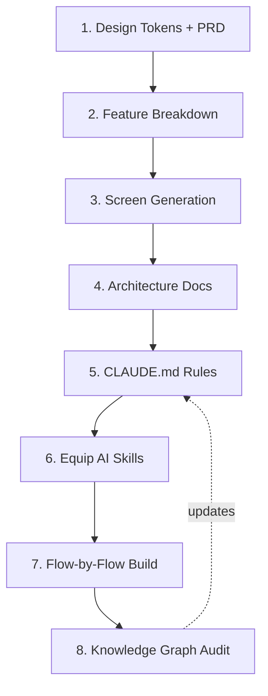

# AI-Assisted Flutter Development Workflow

This document describes the 8-step playbook for building production-grade Flutter apps with an AI coding agent, leveraging design systems, clean architecture, and project-specific skills.

---

## The 8-Step Developer Loop



### Step 1: Design Tokens + PRD
Paste your product requirements document (PRD) into the AI design tool. Generate design tokens (colors, typography, spacing, border radii) as CSS variables or JSON before creating any screens. Save these under `docs/design_systems/tokens/`.

### Step 2: Break the PRD into Features
Ask the AI to parse the PRD and map it into a numbered list of independent feature areas. Create one spec file per feature under `docs/features/` along with an `index.md`. Each file should specify user stories, data models, and feature dependencies.

### Step 3: Screen Specifications feature-by-feature
Develop detailed screen outlines. Identify empty states, loading indicators, offline layouts, and validation error designs. Keep a running screen index under `docs/screen_flow.md`.

### Step 4: Technical Architecture Docs
Detail the database schemas, network paths, and local caching decisions. Document which system acts as the source of truth for each computed value.

### Step 5: CLAUDE.md Configuration
Update `CLAUDE.md` with strict boundaries: features isolation, chosen state management rules, local-first cache expectations, and test coverage targets.

### Step 6: Equip AI Skills
Equip the AI coding assistant with durable skills at `.claude/skills/` (e.g. Clean Architecture scaffolding checklists, design-token check validations, widget overflow tests).

### Step 7: Flow-by-Flow Build
Build one logical flow at a time (e.g., onboarding, user settings) rather than screen-by-screen. Ask the AI to build in order: Domain Entity → Repository Interface → Use Cases → Riverpod Controller → Presentation UI.

### Step 8: Knowledge Graph Audit
Run context auditing tools (like `graphify`) to detect circular imports, feature-boundary violations, or missing abstractions, and feed corrections back into `CLAUDE.md`.

---

## Reusable AI Prompts

### Prompt 1 — Design Tokens + PRD
```markdown
We are building a production-grade Flutter application. Here is our PRD:
[Paste PRD here]

Based on this PRD, create a tokenized design system. Include:
1. Color palette (primary, secondary, semantic accents, neutrals, surfaces).
2. Typographic scale (sizes, line heights, weights).
3. Spacing grid, radius scale, shadow scale, and motion/easing tokens.
4. A short usage-rules note per category.
Output as CSS custom properties (or a token JSON) plus a one-page rationale. Do not write Dart code yet.
```

### Prompt 2 — Feature Spec Breakdown
```markdown
Here is our PRD: [reference or paste it].

Break it into a numbered list of feature areas. For each feature, produce a spec file containing:
1. User stories / jobs-to-be-done.
2. Data entities and screens touched.
3. Dependencies on other features (call out anything that would create a cross-feature import).
4. Safety, security, or regulatory constraints specific to this feature.
Also produce an index.md listing every feature file.
```

### Prompt 3 — Feature-by-Feature Screens
```markdown
Using our design tokens and the feature spec for [Feature Name], generate the screen layout guidelines. Include:
1. Every state per screen: loaded, loading/skeleton, empty, error, offline.
2. A screen ID for each screen (e.g., ONB-01, SET-02).
Add each new screen ID to docs/screen_flow.md. Do not write Flutter widgets yet.
```

### Prompt 4 — Technical Architecture
```markdown
Based on the PRD and the feature specs, write the technical architecture docs for this Flutter app:
1. architecture.md — tech stack, folder structure (Clean Architecture per feature), state management, local database schema, networking strategy, error handling, testing strategy, Definition of Done.
2. A data-flow doc — local schema, remote schema, sync direction, and source of truth rules.
```

### Prompt 5 — Rules Index (CLAUDE.md)
```markdown
Based on architecture.md and data_flow.md, generate CLAUDE.md for this repository:
1. Feature-boundary rules (what a feature may and may not import).
2. State management constraints (Riverpod code-gen rules, no inline widget logic).
3. Data caching rules (Drift SQLite configurations, local-first vs remote-first).
4. Theme rules (no hardcoded color/spacing/typography).
5. Lint/test gates.
```

### Prompt 6 — Equip Skills
```markdown
Create a Claude Code skill at .claude/skills/[skill-name]/SKILL.md for:
[Choose: clean architecture auditing | design-token compliance | responsive layout audits | test generation].
The skill should act as a checklist of rules for the AI coding assistant to verify before finishing feature work, with trigger phrases to fire automatically.
```

### Prompt 7 — Flow-by-Flow Implementation
```markdown
We are ready to implement the [Feature Name] flow (screens: [screen IDs], flow doc: docs/screen_flow.md).
Generate the code in this exact order:
1. Domain entity + Repository interface contract.
2. Domain use case (encodes business rules).
3. Riverpod controller/notifier.
4. Presentation widgets using ThemeExtension design tokens.
When finished, run the responsiveness and boundary audit skills against this flow.
```
